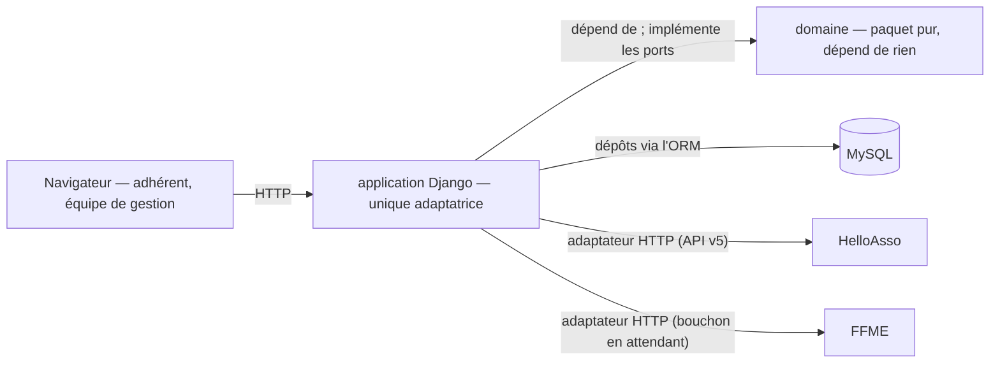
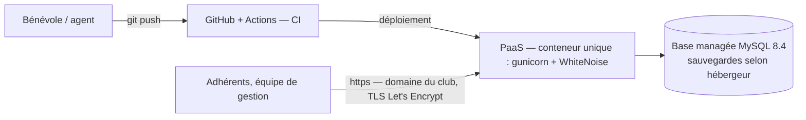

# Architecture Spine — EscaManager, première partie

## Design Paradigm

**Hexagonal (ports et adaptateurs), version légère.** La bibliothèque de domaine est au centre : entités, règles métier, ports. L'application Django, unique adaptatrice, implémente les ports et expose les pages. Mappage sur le code : `domaine/` (paquet pur) et `application/` (projet Django).



## Invariants & Rules

### AD-1 — Le domaine ne dépend de rien

- **Binds:** tous — bibliothèque `domaine/`
- **Prevents:** logique métier liée au web, à la base ou à un protocole : non réutilisable, difficile à tester, inguérissable.
- **Rule:** `domaine/` n'importe que la bibliothèque standard Python ; tout import Django, HTTP, SQL ou client externe y est interdit, vérifié par un test d'imports dans la CI.

### AD-2 — L'application ne contourne jamais le domaine

- **Binds:** tous — `application/`
- **Prevents:** règles métier éparpillées dans les vues ou les modèles, que deux épics peuvent implémenter différemment.
- **Rule:** toute lecture ou écriture d'une entité du domaine passe par un service, une requête ou un port du domaine ; les modèles Django implémentent les dépôts et ne portent aucune règle métier.

### AD-3 — Une application Django par épic, sans import croisé

- **Binds:** R1–R10 — les cinq épics
- **Prevents:** couplage croisé entre épics construites séparément (notamment liste et fédération, parallèles après l'épic adhésions).
- **Rule:** les apps `comptes`, `saisons`, `adhesions`, `membres`, `federation` ne s'importent jamais entre elles ; tout partage passe par `domaine/`, et la composition entre elles se fait uniquement dans `config/` (AD-10).

### AD-4 — Une entité, un propriétaire, un chemin d'écriture

- **Binds:** tous
- **Prevents:** deux rédacteurs du même objet ; écritures partielles hors transaction ; paiements confirmés deux fois.
- **Rule:** chaque entité du domaine a exactement une app propriétaire de sa persistance (AD-9) ; chaque mutation passe par un service du domaine exécuté dans une transaction ; toute mutation née d'un événement externe (notification, webhook HelloAsso) porte une clé d'unicité — rejouer l'événement ne crée pas de doublon.

### AD-5 — Les systèmes externes ne sont connus que par des ports

- **Binds:** R6, R10 — HelloAsso, FFME
- **Prevents:** protocole HTTP dispersé dans les vues ; l'incertitude de l'API FFME bloque l'épic fédération.
- **Rule:** les interfaces des clients HelloAsso et FFME sont déclarées dans `domaine/ports/` ; seuls les adaptateurs de `application/` connaissent le protocole ; le port FFME et son bouchon partagent la sémantique d'états de licence déclarée dans le domaine ; le bouchon vit jusqu'à la recherche API (épic 5). L'adaptateur HelloAsso cible l'API v5 (OAuth2, webhooks, bac à sable, SDK Python officiel — vérifiée le 04/11/2026).

### AD-6 — Rendu serveur, JavaScript en amélioration seulement

- **Binds:** R1–R10 — toutes les pages
- **Prevents:** bifurcation vers une application monopage, pages inutilisables sans JavaScript.
- **Rule:** chaque page fonctionne sans JavaScript ; les endpoints appelés en JS complètent le rendu serveur, jamais ne le remplacent.

### AD-7 — Une seule base relationnelle, SQL uniquement par l'ORM

- **Binds:** tous
- **Prevents:** verrouillage sur un dialecte SQL ; bascule de moteur impossible ; dérive de schéma hors migrations ; bases créées en latin1 par certains hébergeurs.
- **Rule:** cible de déploiement **MySQL 8.4 LTS** (ou la version 8.x LTS proposée par l'hébergeur) ; plancher de compatibilité Django 8.0.11+ / MariaDB 10.5+ via le backend unique `django.db.backends.mysql` — aucun des PaaS candidats ne proposant MariaDB, la cible est MySQL ; charset utf8mb4 imposé par la configuration de connexion ; aucun SQL brut spécifique à un moteur (ni procédure stockée, ni extension) ; les migrations Django sont le seul moyen de changer le schéma.

### AD-8 — Toute fusion passe par la CI

- **Binds:** tous — dépôt GitHub
- **Prevents:** du code non testé ou aux migrations cassées arrive en production ; dérive silencieuse entre contributeurs, agents comme bénévoles.
- **Rule:** chaque fusion traverse GitHub Actions — tests du domaine (sans base), tests de l'application sur MySQL, vérification des migrations — et la CI doit être verte avant fusion.

### AD-9 — Catalogue des entités et de leur propriétaire

- **Binds:** tous — R5, R7, R9, R10 surtout
- **Prevents:** trois apps définissant chacune leur forme de la même personne (comptes pour les données personnelles, adhésions pour le mineur sans compte, membres pour la liste).
- **Rule:** `Compte` et `Permission` appartiennent à `comptes` ; `Saison` et `Option` à `saisons` ; `Adhesion`, `Paiement`, `Adherent` — avec les liens représentant légal, mineur et consentement (R9) — à `adhesions` ; `Licence` à `federation`. Toute nouvelle entité entre au catalogue avant d'être persistée.

### AD-10 — La composition entre apps se fait uniquement dans `config/`

- **Binds:** R10 surtout — fédération × adhésions ; tous les parcours
- **Prevents:** l'épic fédération réécrit ou importe le parcours de l'épic adhésions en violation de AD-3.
- **Rule:** le routage, le câblage des ports et adaptateurs, et l'enchaînement des étapes d'un parcours qui traverse plusieurs apps se composent uniquement dans `application/config/` ; le domaine déclare les points d'accroche nommés qu'une app fournit à un parcours ; une app n'appelle jamais le code d'une autre.

### AD-11 — Les mutations multi-propriétaires sont orchestrées par le domaine

- **Binds:** R2 — effacement RGPD ; toute écriture traversant plusieurs propriétaires
- **Prevents:** effacement partiel silencieux là où AD-3 et AD-4 cloisonnent les entités (Compte dans comptes, Adhesion et Paiement dans adhesions, Licence dans federation).
- **Rule:** toute écriture traversant plusieurs entités propriétaires passe par un service orchestrateur du domaine, un seul chemin, transaction unique ; l'effacement RGPD suit une politique explicite — suppression ou anonymisation, exceptions légales (licences FFME, obligations comptables) — dont le détail est différé à l'épic 1 avec le club.

### AD-12 — Les lectures partagées passent par des requêtes du domaine

- **Binds:** R7, R8 — liste et export
- **Prevents:** deux formes de l'« adhérent » entre la liste de l'épic membres et l'adhésion de l'épic adhésions ; copies dénormalisées qui dérivent.
- **Rule:** la « ligne adhérent » (ce que la liste affiche et que l'export sort) est une requête de lecture déclarée dans `domaine/` ; l'app `membres` rend et exporte cette requête, sans copie ; les corrections de la liste passent par les services de l'app propriétaire de l'entité corrigée.

### AD-13 — Les concepts partagés ont une seule maison

- **Binds:** R4, R5 — saisons, adhésions
- **Prevents:** « saison en cours » et prix calculés différemment par deux épics ; prix d'une adhésion changeant quand la saison est reconfigurée après coup.
- **Rule:** « la saison en cours à une date donnée » et « le prix d'une adhésion » sont calculés par le domaine, en un seul endroit ; une `Saison` porte des dates de début et de fin explicites (l'année sportive du club, par ex. 2026/2027 — jamais une année civile) ; le prix enregistré à l'adhésion est une photo des prix de la saison au moment de l'adhésion.

### AD-14 — Vocabulaire unique des permissions, rôles en données

- **Binds:** R3
- **Prevents:** permissions nommées différemment selon les épics ; rôles du club codés en dur dans une app.
- **Rule:** les permissions sont des identifiants stables nommés dans `domaine/` (format unique, une seule liste) ; les rôles nommés du club (président, trésorier, secrétaire, membre du CA, adhérent) sont des ensembles de permissions enregistrés en données, jamais codés en dur ni référencés dans le code.

### AD-15 — Neutralité d'hébergement

- **Binds:** tous — déploiement
- **Prevents:** verrouillage sur un PaaS précis ; une story introduit une dépendance propre à un hébergeur (buildpack, SDK, configuration implicite).
- **Rule:** l'application se déploie sur toute infrastructure exécutant Python : point d'entrée WSGI standard, configuration exclusive par variables d'environnement, aucune dépendance ni fonction propre à un hébergeur ; la piste de démarrage (Scalingo) est un choix d'exploitation, jamais du code.

## Consistency Conventions

| Aspect | Convention |
| --- | --- |
| Nommage | symboles, apps Django et URLs en français, snake_case — apps : `comptes`, `saisons`, `adhesions`, `membres`, `federation` |
| Langue | interface, documentation et commentaires en français ; textes écrits directement en français, sans catalogues i18n |
| Rendu | responsif : chaque page utilisable sur mobile comme sur ordinateur |
| Données et formats | montants en décimal exact (`Decimal`, jamais float) ; dates en ISO en interne, fuseau Europe/Paris explicite, affichage en français ; identifiants internes auto-incrémentés |
| État et transversal | une mutation = un service du domaine en transaction (idempotent pour les événements externes) ; permissions vérifiées par un mécanisme unique ; erreurs présentées en français ; journalisation standard Django ; secrets exclusivement en variables d'environnement |
| RGPD | minimisation des données collectées ; consentement enregistré comme donnée (R9) ; exercice des droits sans intervention technique, via AD-11 |
| Dépendances | toute dépendance nouvelle est open-source et gratuite, disponible sans engagement commercial |
| Tests | le domaine se teste sans base (paquet pur) ; l'application se teste sur MySQL, pas SQLite (écarts de collation) |

## Stack

| Nom | Version |
| --- | --- |
| Python | 3.13 |
| Django | 5.2 LTS |
| Base de données | MySQL 8.4 LTS (cible) — plancher backend 8.0.11+ / MariaDB 10.5+ |
| Pilote BDD | mysqlclient 2.3.0 |
| Paiement en ligne | HelloAsso — API v5 |
| Courriels transactionnels | Brevo — offre gratuite (relais SMTP) |
| CI | GitHub Actions |
| Hébergement | PaaS — piste Scalingo à l'épic 1 ; code hébergeable partout (AD-15) |

## Structural Seed

Déploiement et environnements :



Environnements : **local** (développement) et **production** (PaaS) ; la CI exécute les tests sur MySQL comme en production. Pas d'environnement intermédiaire dans cette première partie. Sauvegardes : quotidiennes et incluses chez Scalingo et Clever Cloud ; manuelles (mysqldump) sur PythonAnywhere — ce fait pèse dans le choix de l'épic 1, qui teste aussi une restauration.

```text
{racine}/
  domaine/              # bibliothèque de domaine — paquet pur, testable sans base
    entites/            # Compte, Permission, Saison, Option, Adhesion, Paiement, Adherent, Licence…
    ports/              # dépôts, requêtes de lecture et clients externes (interfaces uniquement)
    services/           # règles métier et orchestrateurs ; une mutation = un service
  application/          # projet Django — l'unique adaptatrice
    config/             # réglages, urls, câblage des ports et adaptateurs, composition des parcours
    comptes/            # épic 1 : comptes, permissions, données personnelles (RGPD) — Compte, Permission
    saisons/            # épic 2 : configuration des saisons — Saison, Option
    adhesions/          # épic 3 : parcours d'adhésion, HelloAsso (API v5), paiements hors ligne,
                        #        Adherent, représentant légal, mineurs, consentement (R9)
    membres/            # épic 4 : liste des adhérents, export tableur (requête ligne adhérent, AD-12)
    federation/         # épic 5 : adaptateur FFME (port avec bouchon) — Licence
    gabarits/ static/
  tests/
```

## Capability → Architecture Map

| Capacité / zone | Vit dans | Régie par |
| --- | --- | --- |
| R1–R3 — comptes, RGPD, permissions | `comptes` — entités `Compte`, `Permission` | AD-1 à AD-4, AD-6, AD-8, AD-11, AD-14 |
| R4 — saisons et options | `saisons` — entités `Saison`, `Option` | AD-1 à AD-4, AD-6, AD-8, AD-13 |
| R5, R6, R9 — adhésion, paiement, mineurs | `adhesions` — entités `Adhesion`, `Paiement`, `Adherent` (représentant, consentement) + port HelloAsso | AD-1 à AD-6, AD-8, AD-9, AD-13 |
| R7, R8 — liste et export | `membres` — requête « ligne adhérent » du domaine | AD-1 à AD-4, AD-6, AD-8, AD-12 |
| R10 — licence FFME | `federation` — port FFME (bouchon) + accroche composée dans `config/` | AD-1 à AD-5, AD-8, AD-10 |

## Deferred

- Le plan exact chez Scalingo (piste retenue au raffinement de l'épic 1, 04/11/2026) — prix du petit conteneur à confirmer à la story socle ; le code reste hébergeable partout (AD-15).
- La politique de conservation RGPD exacte (suppression ou anonymisation, exceptions légales — licences FFME, obligations comptables) — épic 1, avec le club ; le mécanisme est déjà fixé par AD-11.
- Le mode du dépôt GitHub (public ou privé) — épic 1 ; GitHub Actions est gratuit dans les deux cas.
- L'outillage du rendu (CSS, gabarits, HTMX ou JS simple) — épic 1, idéalement après un passage `bmad-ux` sur l'identité visuelle du club.
- Le détail du flux HelloAsso (redirection, webhooks, reçu, sandbox) — raffinement de l'épic 3 ; l'API v5 est vérifiée et vivante.
- L'API FFME réelle — recherche `bmad-deep-recon` avant le raffinement de l'épic 5 : aucune API publique tierce trouvée à ce jour (04/11/2026), la piste centrale est la passerelle officielle HelloAsso vers myFFME (active pour 2026-2027) ; la vérification de licence existante reste le risque résiduel ; le bouchon (AD-5) découpe en attendant.
- Les ensembles de permissions concrets (rôles nommés du club) — épic 1.
- Sauvegarde au-delà de l'hébergeur et supervision (au-delà des logs du PaaS et d'une vérification de disponibilité), recherche plein-texte — non requis par la première partie.
